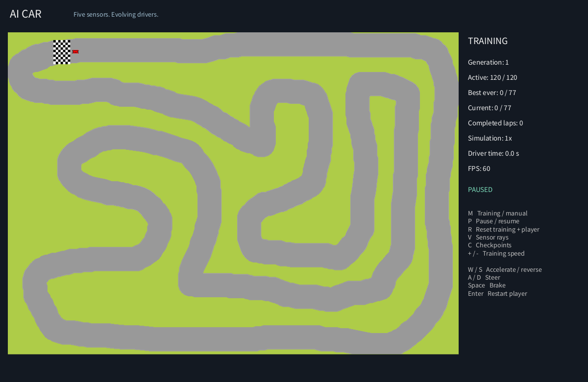

# AI Car

A Processing sketch where a population of cars evolves small neural controllers to find its way around a racetrack.

I built the original version over five years ago. It was the project that got me into machine learning and computer science. This repository preserves that starting point, with repairs that make it runnable and easier to explore today.



## Run the sketch

1. Install [Processing 4](https://processing.org/download) and use **Java mode**.
2. Clone or download this repository. The sketch folder must be named `AI_Car`; rename it if your download adds a suffix such as `-main`.
3. Open `AI_Car.pde` inside that folder. Processing should show all six sketch tabs, with the `data/` folder alongside them.
4. Click **Run**. Training starts automatically in a 1200 x 780 window.

The sketch uses Processing's built-in libraries. Python and a separate JDK are only needed for the headless tests below.

## How it learns

Each of the 120 cars observes five distances to the track boundary and its current speed. A controller with two outputs and 14 weights produces throttle and steering using a `tanh` activation. Ordered checkpoints measure progress; their positions are not inputs to the controller.

At the end of each generation, the best controller is preserved unchanged. Tournament selection chooses parents for mutated offspring, and roughly 10% of the next generation starts with random controllers to maintain diversity. Crashes, completed laps, and time limits end a driver's run.

This is neuroevolution: controller weights evolve through selection and mutation. There is no backpropagation or pretrained model.

## Controls

| Key | Action |
| --- | --- |
| M | Switch between AI training and manual driving |
| W / S | Accelerate forward / reverse in manual mode |
| A / D | Steer in manual mode |
| Space | Brake in manual mode |
| Enter | Restart the manual car |
| P | Pause / resume |
| R | Reset training and the manual car |
| V | Show the leading car's five sensor rays |
| C | Show ordered checkpoints |
| + / - | Set 1-10 simulation steps per frame |

Training pauses while you drive manually and resumes when you switch back. Press Enter after crashing or finishing a lap. The timer measures simulation seconds at 60 steps per second, so it advances faster at higher training speeds. The green car carries the best controller from completed generations; red cars are other AI drivers, and the gray car is the player.

## Project layout

| File | Purpose |
| --- | --- |
| `AI_Car.pde` | Setup, checkpoints, drawing, controls, and simulation settings |
| `Brain.pde` | Controller weights, decisions, copying, and mutation |
| `Car.pde` | Movement, collision, checkpoint progress, and fitness |
| `population.pde` | Generations, tournament selection, and elite preservation |
| `checkForWall.pde` | Five bounded distance sensors |
| `map.pde` | Track rendering and an immutable collision mask |
| `data/` | Original track images and car sprites |
| `tests/` | Headless simulation checks and frame rendering |

## Testing

Install Python 3 and a Java 17+ **JDK**, then run from the sketch folder:

```sh
python tests/run_tests.py --core "/path/to/processing/core/library/core.jar" --render preview.png
```

Replace the example with the actual `core.jar` path in your Processing installation. Quote paths containing spaces, especially on Windows. No third-party Python packages are needed. If only a Java runtime is available, supply `--ecj "/path/to/ecj.jar"` for an Eclipse Java compiler. The runner downloads nothing and builds in a temporary directory.

The suite compiles the actual PDE tabs and checks initialization, collision, bounded sensors, manual acceleration and braking, stalled drivers, lap completion, elite preservation, offspring diversity, evolutionary improvement, and reset. With Processing Core 4.3.1, the fixed-seed run passes **26 checks** and completes **77/77 checkpoints** within 30 generations. Other random runs may progress differently.

GitHub Actions runs the suite on Windows and Linux with Java 17 and a checksum-verified Processing Core 4.3.1 JAR from Maven Central. Each run uploads a rendered frame. The screenshot above comes from the actual `draw()` function via Processing's Java2D renderer. Desktop window behavior and physical keyboard input require a manual check in the IDE.

## Exploring the project

Population size, generation limits, sensor range, and checkpoint radius are set at the top of `AI_Car.pde`. The regression suite expects the default population size of 120.

The active track is `data/RaceTrack5.png`. Other original maps are retained, but switching tracks also requires matching checkpoints and a valid spawn position. The collision mask uses PNG opacity, so replacement tracks must encode the drivable area appropriately.

Controllers stay in memory for the current run. Closing the sketch or resetting it starts training again; there is no saved-model format.

See [restoration notes](docs/restoration.md) for the repairs present in this working copy and [contributing notes](CONTRIBUTING.md) for development guidance.
